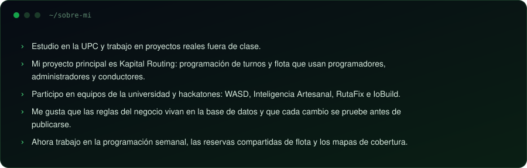
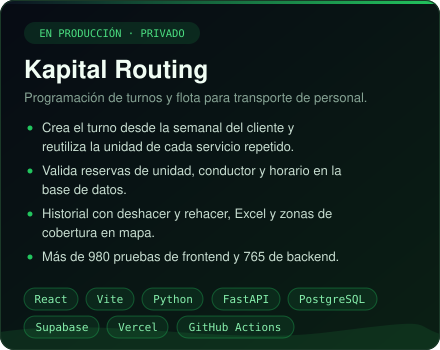
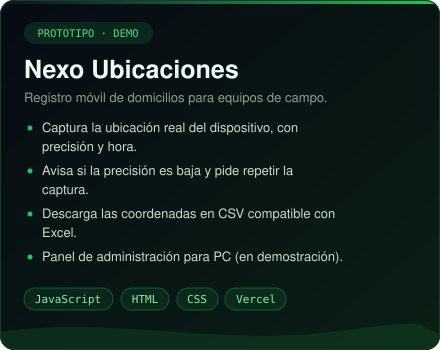
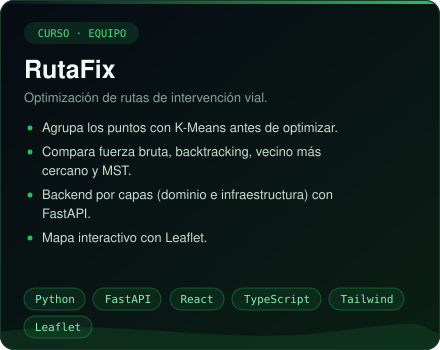
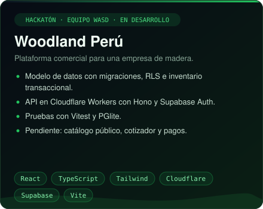

 

  
  

  
  

**También:**
[FacturaSnap](https://facturasnap-web.vercel.app) (calculadora de IGV para facturas SUNAT) ·
[WASD Connect](https://github.com/W-A-S-D-2-0/wasd-connect) (mapa y reservas para pymes) ·
[Qlic](https://github.com/wasd25/qlic-frontend) ·
[OsitoPolar](https://github.com/Inteligencia-Artesanal-Aplicaciones-Web/OsitoPolar-Frontend)

 

<table>
<tr><td><b>Frontend</b></td><td></td></tr>
<tr><td><b>Backend</b></td><td></td></tr>
<tr><td><b>Datos</b></td><td></td></tr>
<tr><td><b>Infra y CI</b></td><td></td></tr>
<tr><td><b>Pruebas</b></td><td></td></tr>
<tr><td><b>Diseño</b></td><td></td></tr>
</table>

 

&nbsp;
&nbsp;
&nbsp;
&nbsp;
&nbsp;

<picture>
  <source media="(prefers-color-scheme: dark)" srcset="https://raw.githubusercontent.com/Everkoe/Everkoe/main/profile-3d-contrib/profile-night-green.svg" />
  
</picture>

<picture>
  <source media="(prefers-color-scheme: dark)" srcset="https://raw.githubusercontent.com/Everkoe/Everkoe/output/github-snake-dark.svg" />
  
</picture>

