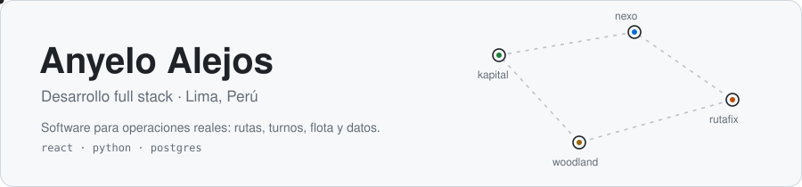

 

## 🚀 Proyecto principal: Kapital Routing

Plataforma web de programación y ruteo de transporte de personal, **en producción y en uso diario** por programadores, administradores y conductores. *(Repositorio privado.)*

 

 

<table width="100%">
<tr>
<td width="50%" valign="top">

**🗓️ Programación por turnos**
Crea el turno desde la semanal del cliente, reutiliza la unidad de cada servicio repetido y deja en pendientes lo que no puede asignar, con el motivo.

**🔒 Reservas compartidas de flota**
Un cruce de unidad, conductor, hora y sentido se rechaza también en la base de datos, con bloqueo transaccional.

**↩️ Edición con historial**
Deshacer y rehacer, versiones, guardado idempotente y borradores antes de aplicar.

</td>
<td width="50%" valign="top">

**📊 Excel de varios clientes**
Importa y exporta formatos distintos, con detección automática de sede.

**🗺️ Zonas de cobertura en mapa**
Polígonos dibujados por el usuario con Google Maps JavaScript.

**🛡️ Roles y accesos**
Sesión por cookie HttpOnly y permisos derivados en el servidor, con cuentas por operación.

</td>
</tr>
</table>

 

## 🧩 Stack

 

## 🛠️ Otros proyectos

<table width="100%">
<tr>
<td width="50%" valign="top">

### [🧾 FacturaSnap](https://github.com/Everkoe/facturasnap-web)
Calculadora de IGV y precio unitario para facturas con formato SUNAT.

`React` `TypeScript`

</td>
<td width="50%" valign="top">

### 📍 Nexo Ubicaciones *(privado)*
Prototipo de registro móvil de domicilios y administración de ubicaciones.

`JavaScript`

</td>
</tr>
</table>

 

## 🎯 Lo que me interesa

- 🧠 Modelar reglas de negocio reales (turnos, disponibilidad, conflictos) y validarlas en la base de datos, no solo en la interfaz.
- ♿ Interfaces claras, accesibles y con movimiento reducido.
- 🧪 Probar antes de publicar: datos ficticios, SQL efímero y CI.

 

## 📬 Contacto

  

