 

Estudio en la UPC y construyo software para operaciones: turnos, rutas, flota y ubicaciones.
Me gusta que las reglas vivan en la base de datos y que cada cambio se pruebe antes de publicarse.

### Proyectos

### Stack

### Actividad

 

<a href="https://www.linkedin.com/in/anyelo-bill-alejos-jesus-930200309/">LinkedIn</a> &nbsp;·&nbsp;
<a href="mailto:anyelobill31@gmail.com">anyelobill31@gmail.com</a> &nbsp;·&nbsp;
<a href="https://github.com/W-A-S-D-2-0">WASD</a> &nbsp;·&nbsp;
<a href="https://github.com/Inteligencia-Artesanal-Aplicaciones-Web">Inteligencia Artesanal</a>

