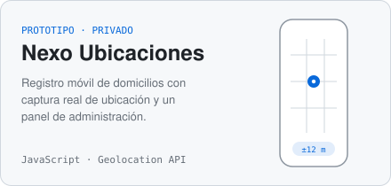
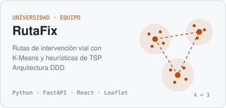
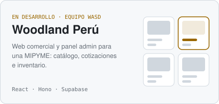

Hago software para operaciones: programación de turnos, rutas, flota y registro de ubicaciones.
Me interesa que las reglas del negocio vivan en un solo lugar, que se puedan probar y que la
herramienta la use gente de verdad todos los días.

Trabajo solo en algunos proyectos y en equipo en otros (UPC y hackatones).
Abajo está lo más reciente.

## Proyectos

<table>
<tr>
<td width="50%"></td>
<td width="50%"></td>
</tr>
<tr>
<td width="50%"></td>
<td width="50%"></td>
</tr>
</table>

**Kapital Routing** (privado). Plataforma en producción para programar turnos de transporte de
personal a partir de la semanal del cliente. Las reservas de unidad, conductor y horario se
validan en PostgreSQL, hay historial con deshacer y rehacer, importación y exportación de Excel
y zonas de cobertura en mapa. Tiene unas 980 pruebas de frontend, 765 de backend y ensayos de SQL
con PGlite antes de cada migración.

**Nexo Ubicaciones** (privado, demo pública). Propuesta de registro móvil de domicilios:
captura la ubicación con la API del navegador, muestra la precisión y exporta a CSV. El panel
de administración sigue siendo una demostración.

**RutaFix.** Proyecto del curso de Complejidad Algorítmica: agrupa puntos de intervención con
K-Means y calcula la ruta de cada cuadrilla con fuerza bruta, backtracking, vecino más cercano y
MST. Backend en FastAPI con capas de dominio, frontend en React con Leaflet.

**Woodland Perú.** Plataforma comercial para una MIPYME hecha por el equipo WASD en una
hackatón: web con catálogo y cotizaciones y panel para inventario y pedidos. Está en la fase de
datos y seguridad (modelo, RLS, inventario transaccional). El catálogo público y los pagos
todavía no están.

## También

| | |
|---|---|
| [FacturaSnap](https://facturasnap-web.vercel.app) | Calculadora de IGV y precio unitario para facturas con formato SUNAT. React y TypeScript. |
| [WASD Connect](https://github.com/W-A-S-D-2-0/wasd-connect) | Mapa y reservas para pymes de Lima. Next.js, Drizzle y Postgres. |
| [Qlic](https://github.com/wasd25/qlic-frontend) | Producto web del curso de Aplicaciones Web, equipo WASD. Vue y C#. |
| [OsitoPolar](https://github.com/Inteligencia-Artesanal-Aplicaciones-Web/OsitoPolar-Frontend) | Aplicación web del curso, equipo Inteligencia Artesanal. Vue y C#. |

## Herramientas

Con las que trabajo a diario:

Las que he usado en equipos y cursos:

## Contacto

[LinkedIn](https://www.linkedin.com/in/anyelo-bill-alejos-jesus-930200309/) ·
[anyelobill31@gmail.com](mailto:anyelobill31@gmail.com)
