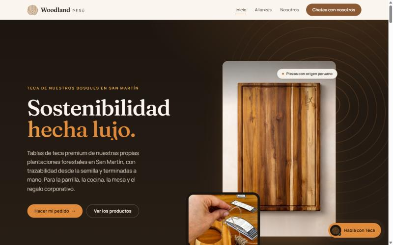
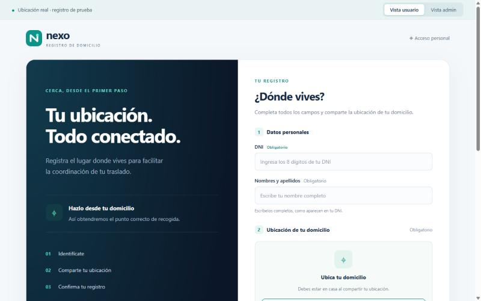
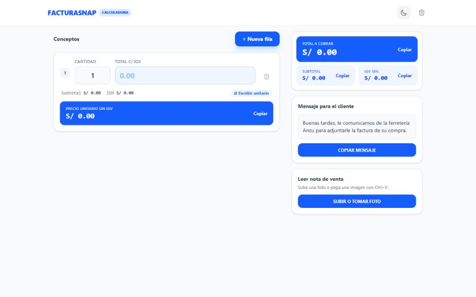

## Sobre mí

- Estudio en la **UPC** y trabajo en proyectos reales fuera de clase.
- Mi proyecto principal es **Kapital Routing**: programación de turnos y flota que usan programadores, administradores y conductores.
- Participo en equipos de la universidad y hackatones: **WASD**, **Inteligencia Artesanal**, **RutaFix** e **IoBuild**.
- Me gusta que las reglas del negocio vivan en la base de datos y que cada cambio se pruebe antes de publicarse.
- Ahora trabajo en la programación semanal, las reservas compartidas de flota y los mapas de cobertura.

## Kapital Routing

Plataforma en producción para programar turnos de transporte de personal. El repositorio es privado.

- Crea el turno desde la semanal del cliente y reutiliza la unidad de cada servicio repetido.
- Valida reservas de unidad, conductor y horario en PostgreSQL, con bloqueo transaccional.
- Historial con deshacer y rehacer, importación y exportación de Excel y zonas de cobertura en mapa.
- Más de 980 pruebas de frontend y 765 de backend. Cada migración de SQL se ensaya antes con PGlite y datos ficticios.
- React, Vite, FastAPI, PostgreSQL y Supabase, desplegado con GitHub Actions y Vercel.

## Otros proyectos

<table>
<tr>
<td width="50%" valign="top">

 
<b><a href="https://woodland-peru-web-wasd-9268.vercel.app/">Woodland Perú</a></b> · hackatón, equipo WASD 
Web comercial y panel administrativo de una empresa de tablas de teca, con React y Cloudflare Workers sobre Supabase. En desarrollo: faltan el cotizador y los pagos.
</td>
<td width="50%" valign="top">

 
<b><a href="https://nexo-ubicaciones.vercel.app">Nexo Ubicaciones</a></b> · prototipo 
Registro móvil de domicilios. Captura la ubicación real del dispositivo con su precisión, avisa si es baja y exporta las coordenadas a CSV. El panel de administración es una demostración.
</td>
</tr>
<tr>
<td width="50%" valign="top">

 
<b><a href="https://facturasnap-web.vercel.app">FacturaSnap</a></b> 
Calculadora de IGV y precio unitario para facturas con formato SUNAT. React y TypeScript.
</td>
<td width="50%" valign="top">
 
<b><a href="https://github.com/ComplejidadAlgoritmica-Rutafix/FinalProyect-Rutafix">RutaFix</a></b> · curso de Complejidad Algorítmica, equipo 
Optimización de rutas de intervención vial: agrupa los puntos con K-Means y compara fuerza bruta, backtracking, vecino más cercano y MST. FastAPI por capas y mapa con Leaflet.
  
También: <a href="https://github.com/W-A-S-D-2-0/wasd-connect">WASD Connect</a>, <a href="https://github.com/wasd25/qlic-frontend">Qlic</a> y <a href="https://github.com/Inteligencia-Artesanal-Aplicaciones-Web/OsitoPolar-Frontend">OsitoPolar</a>.
</td>
</tr>
</table>

## Stack

**Frontend** 

**Backend y datos** 

**Infraestructura, pruebas y diseño** 

## Equipos

&nbsp;
&nbsp;
&nbsp;
&nbsp;
&nbsp;

## Actividad

<picture>
  <source media="(prefers-color-scheme: dark)" srcset="https://raw.githubusercontent.com/Everkoe/Everkoe/main/profile-3d-contrib/profile-night-green.svg" />
  
</picture>

<picture>
  <source media="(prefers-color-scheme: dark)" srcset="https://raw.githubusercontent.com/Everkoe/Everkoe/output/github-snake-dark.svg" />
  
</picture>

## Contacto

