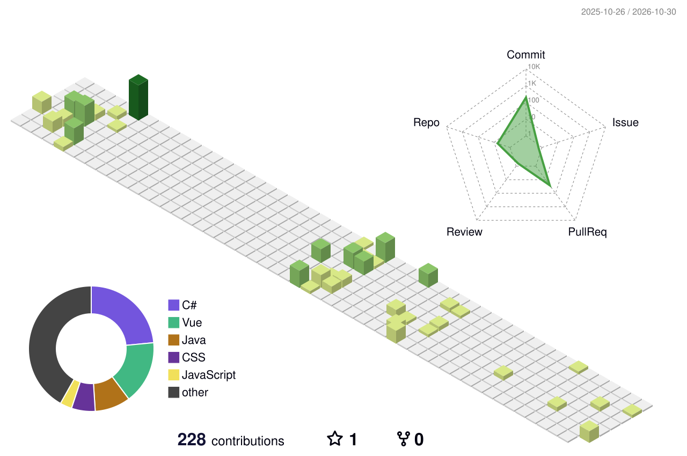

## Sobre mí

- Estudio en la **Universidad Peruana de Ciencias Aplicadas (UPC)** y trabajo en proyectos reales fuera de clase.
- Mi proyecto principal es **Kapital Routing**, una plataforma de programación de turnos y flota que ya usan programadores, administradores y conductores.
- Participo en equipos de la universidad y en hackatones: **WASD**, **Inteligencia Artesanal**, **RutaFix** e **IoBuild**.
- Me gusta que las reglas del negocio vivan en la base de datos y que cada cambio se pruebe antes de publicarse.
- Ahora mismo trabajo en la programación semanal, las reservas compartidas de flota y los mapas de cobertura.

## Proyectos destacados

<table width="100%">
<tr>
<td width="50%" valign="top">

### Kapital Routing
<b>EN PRODUCCIÓN</b> · repositorio privado

Programación de turnos y flota para transporte de personal, construida desde cero.

- Crea el turno desde la semanal del cliente y reutiliza la unidad de cada servicio repetido.
- Valida reservas de unidad, conductor y horario en la base de datos, con bloqueo transaccional.
- Historial con deshacer y rehacer, importación y exportación de Excel, zonas de cobertura en mapa.
- Más de 980 pruebas de frontend y 765 de backend.

</td>
<td width="50%" valign="top">

### Nexo Ubicaciones
<b>PROTOTIPO</b> · <a href="https://nexo-ubicaciones.vercel.app">demo</a> · repositorio privado

Registro móvil de domicilios para equipos de campo.

- Captura la ubicación real del dispositivo y muestra precisión y hora.
- Avisa si la precisión es baja y pide repetir la captura.
- Descarga las coordenadas en CSV compatible con Excel.
- Panel de administración para PC (en demostración).

</td>
</tr>
<tr>
<td width="50%" valign="top">

### <a href="https://github.com/ComplejidadAlgoritmica-Rutafix/FinalProyect-Rutafix">RutaFix</a>
<b>CURSO DE COMPLEJIDAD ALGORÍTMICA</b> · equipo

Optimización de rutas de intervención vial.

- Agrupa los puntos con K-Means antes de optimizar.
- Compara fuerza bruta, backtracking, vecino más cercano y MST para el problema del viajero.
- Backend en capas (dominio e infraestructura) con FastAPI.
- Mapa interactivo con Leaflet.

</td>
<td width="50%" valign="top">

### <a href="https://github.com/W-A-S-D-2-0/woodlandsperu-main">Woodland Perú</a>
<b>HACKATÓN TRANSFORMA+ MIPYME</b> · equipo WASD · en desarrollo

Plataforma comercial para una empresa de madera: web de catálogo y panel administrativo.

- Modelo de datos con migraciones, políticas RLS e inventario transaccional.
- API en Cloudflare Workers con Hono y acceso del personal con Supabase Auth.
- Pruebas con Vitest y PGlite.
- Pendiente: catálogo público, cotizador y pagos.

</td>
</tr>
</table>

### También

| Proyecto | Qué es | Stack |
|---|---|---|
| [FacturaSnap](https://facturasnap-web.vercel.app) | Calculadora de IGV y precio unitario para facturas con formato SUNAT. | React, TypeScript |
| [WASD Connect](https://github.com/W-A-S-D-2-0/wasd-connect) | Mapa y reservas para pymes de Lima. | Next.js, Drizzle, Postgres |
| [Qlic](https://github.com/wasd25/qlic-frontend) | Producto web del curso de Aplicaciones Web (equipo WASD). | Vue, C# |
| [OsitoPolar](https://github.com/Inteligencia-Artesanal-Aplicaciones-Web/OsitoPolar-Frontend) | Aplicación web del curso (equipo Inteligencia Artesanal). | Vue, C# |

## Stack

| | |
|---|---|
| **Frontend** |  |
| **Backend** |  |
| **Datos** |  |
| **Infra y CI** |  |
| **Pruebas** |  |
| **Diseño** |  |

## Equipos y organizaciones

&nbsp;
&nbsp;
&nbsp;
&nbsp;
&nbsp;

## Actividad

<picture>
  <source media="(prefers-color-scheme: dark)" srcset="https://raw.githubusercontent.com/Everkoe/Everkoe/main/profile-3d-contrib/profile-night-green.svg" />
  
</picture>

<picture>
  <source media="(prefers-color-scheme: dark)" srcset="https://raw.githubusercontent.com/Everkoe/Everkoe/output/github-snake-dark.svg" />
  
</picture>

## Contacto

